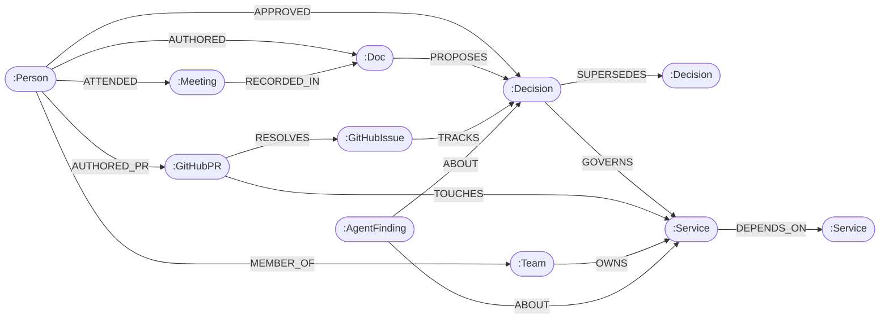

<div align="center">

# 🧠 CompanyMind AI
### Autonomous Enterprise Graph Brain & Cross-Agent Shared Memory

[](https://falkordb.com)
[](https://www.wemakedevs.org/hackathons/falkordb)
[]()
[]()

**Give your AI agents real company context.**  
CompanyMind AI connects Google Workspace meeting notes & RFC docs with GitHub PRs, issues, and microservice infrastructure into an ultra-fast, queryable graph brain powered by **FalkorDB**.

[Architecture Specification](docs/ARCHITECTURE.md) • [Getting Started](#-quickstart) • [Graph Model](#-graph-data-model) • [Demo Scenarios](#-demo-scenarios)

</div>

---

## 📌 Executive Summary

Modern companies suffer from **knowledge fragmentation**:
- **Why decisions were made** sits in Google Meet transcripts and executive meeting notes.
- **Architectural specifications** sit in Google Docs RFCs.
- **Tasks & bug tickets** sit in GitHub / Jira issues.
- **Code implementation** sits in GitHub PRs and commits.
- **Production dependencies** sit in microservice architectures.

When an engineer or leader asks:  
> *"Why did we deprecate the v1 Auth Service, who approved it, and what downstream services break if we shut it down?"*

Standard **Vector Search (RAG)** fails because text embeddings cannot follow causal chains or calculate variable-depth blast radiuses.  
Standard **SQL** fails because recursive traversals across dynamic entity graphs require unmaintainable multi-table joins.

**CompanyMind AI solves this by turning corporate memory into a directed graph inside FalkorDB.** The graph shapes what agents do, serves as cross-agent shared memory, and returns auditable traversal paths for every answer.

---

## 🎯 Hackathon Tracks Entered

1. **Track 03: Company Brain (Primary)**  
   * Connects people, teams, projects, documents, decisions, and code into one unified graph.
   * Full decision provenance: traces any technical rule back to the exact meeting and author.
   * Cross-team blast-radius impact analysis across microservices.
2. **Track 02: Agent Memory and Coordination (Secondary)**  
   * Acts as a persistent, low-latency episodic and procedural memory layer across multiple autonomous agents (Ingestor, Watchdog, Oracle).
   * Agents write newly verified findings into the graph to preserve context across sessions without context window bloat.

---

## 📊 Graph Data Model



---

## ⚡ Key Capabilities

* **🔗 Multi-Source Ingestion via MCP:** Seamlessly connects Google Workspace (Docs/Meet) and GitHub (PRs/Issues) through the Model Context Protocol (MCP).
* **🔍 Decision Provenance:** Traces any production constraint back to the meeting, RFC document, and approving executive.
* **💥 Recursive Blast-Radius Analysis:** Evaluates upstream and downstream impact using variable-depth Cypher traversals (`*1..$depth`).
* **🛡️ Autonomous PR Governance Watchdog:** Automatically audits incoming pull requests against active architectural decisions in meeting notes.
* **🧠 Persistent Agent Memory:** Writes agent conclusions into FalkorDB as `:AgentFinding` nodes, recallable across sessions.
* **🧭 Path-Carried Explainability:** Returns `[n IN nodes(path) | n.name]` alongside answers to visually illustrate how the agent reached every conclusion.

---

## 🛠️ Tech Stack

- **Graph Database:** [FalkorDB](https://falkordb.com) (in-memory GraphBLAS engine + Redis protocol)
- **Backend API & Agent Loop:** Python 3.12, FastAPI, `falkordb` official client, LiteLLM / Gemini
- **Protocol:** Model Context Protocol (MCP) for tool execution
- **Frontend / Visualization:** Next.js / React, TailwindCSS, Cytoscape.js interactive graph canvas

---

## 🚀 Quickstart

### 1. Prerequisites
- Docker
- Python 3.12+
- Node.js 20+

### 2. Start FalkorDB
```bash
# Starts FalkorDB on port 6379 and FalkorDB Browser on port 3000
docker run -d --name falkordb -p 6379:6379 -p 3000:3000 falkordb/falkordb:latest
```
Access the visual graph inspector at [http://localhost:3000](http://localhost:3000).

### 3. Setup Backend & Seed Graph
```bash
python3 -m venv .venv
source .venv/bin/activate
pip install -r requirements.txt

# Seed the enterprise graph with realistic Google Workspace & GitHub data
python scripts/seed_graph.py
```

### 4. Run the API Server
```bash
uvicorn app.main:app --reload --port 8000
```

---

## 🎬 Demo Scenarios: 1-Hop vs. 4-Hop Reasoning

| Scenario | 1-Hop Query (What standard DBs do) | 4-Hop Graph Traversal (CompanyMind Power) |
| :--- | :--- | :--- |
| **Service Deprecation** | Shows direct callers of `auth-v1`. | Traces `mobile-checkout → payments-api → api-gateway → auth-v1`, while linking backward to `RFC-102`, `Q3 Arch Review`, and the approving CTO. |
| **PR Governance** | Shows the file modified in the PR. | Detects that the modified auth header violates `Decision DEC-88` passed in last week's Security All-Hands. |
| **Expertise Finder** | Shows who submitted the latest commit. | Weighted ranking based on RFC authorship, PR merges, and incident triage history. |

---

## 📄 License
This project is licensed under the Apache 2.0 License.
