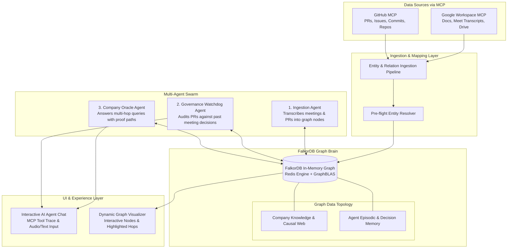
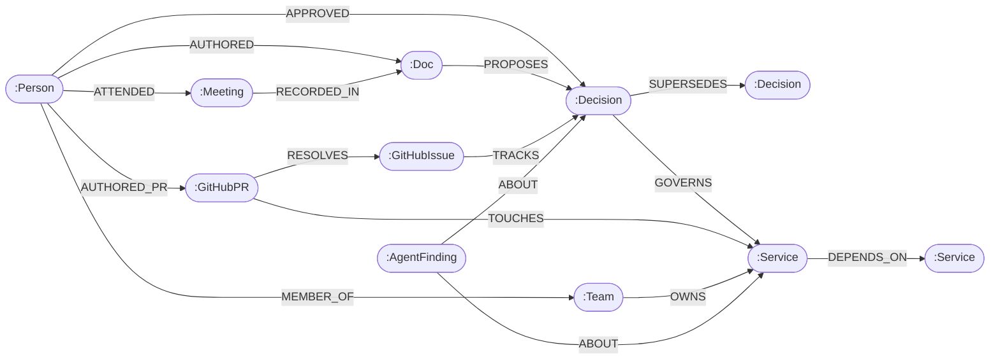

# CompanyMind AI — Architecture & System Design

> **Autonomous Enterprise Graph Brain & Cross-Agent Shared Memory**  
> *Built with FalkorDB for the WeMakeDevs Graph Hacks Hackathon 2026*  
> **Target Tracks:** Track 3 (Company Brain) & Track 2 (Agent Memory and Coordination)

---

## 1. Executive Summary & Problem Statement

In modern organizations, critical institutional knowledge is heavily fragmented across siloed systems:
- **Strategic intent & rationale** live in Google Meet transcripts and executive meeting notes.
- **Architectural specifications & RFCs** live in Google Docs and Drive folders.
- **Task commitments & bug reports** live in GitHub/Jira issues.
- **Actual execution & technical debt** live in GitHub PRs, commits, and codebases.
- **Production services & deployments** live in cloud infrastructure.

### The Problem with Existing Approaches (SQL & Vector RAG)
When an engineer or leader asks:
> *"Why did we deprecate the v1 Auth Service, who authorized it, and what downstream systems break if we shut it down next Monday?"*

- **Standard SQL Relational Databases** fail because tracing this requires an 8-table join across dynamic, variable-depth entity hierarchies.
- **Standard Vector RAG (Semantic Search)** fails because it retrieves disconnected text chunks. It cannot reconstruct chronological cause-and-effect or follow multi-hop dependency chains. It guesses joins that were never recorded.

### The Solution: CompanyMind AI
**CompanyMind AI** constructs a living, causal knowledge and governance graph inside **FalkorDB**. 
By connecting **Google Workspace** and **GitHub** through Composio, CompanyMind is designed to synthesize meeting decisions, architectural RFCs, GitHub PRs, and team ownership into an interconnected graph. 

Furthermore, CompanyMind serves as the **persistent, shared memory layer across autonomous agents**, preventing context window bloat and ensuring every decision is auditable back to its human source.

---

## 2. System Architecture



---

## 3. Graph Data Model & Schema Specification

The graph model connects people, governance, code, and infrastructure.



### Node Types
| Node Label | Key Properties | Purpose |
| :--- | :--- | :--- |
| `:Person` | `name`, `email`, `role`, `team` | Employees, engineers, team leads, executives. |
| `:Team` | `name`, `department`, `lead` | Organizational units (e.g., Core Infra, Checkout, Security). |
| `:Meeting` | `id`, `title`, `date`, `summary` | Google Meet or synced calendar discussions. |
| `:Doc` | `id`, `title`, `url`, `type` (`RFC`, `Report`, `Postmortem`) | Google Docs, RFC specifications, architecture records. |
| `:Decision` | `id`, `title`, `rationale`, `status`, `date` | Concrete decisions agreed upon in meetings or documents. |
| `:Service` | `name`, `tier`, `repo_url`, `language` | Production systems, microservices, databases, and APIs. |
| `:GitHubPR` | `number`, `title`, `author`, `state`, `merged_at` | Code pull requests modifying services. |
| `:GitHubIssue` | `number`, `title`, `status`, `priority` | Tasks, epics, and bug reports. |
| `:AgentFinding` | `id`, `text`, `session_id`, `at`, `severity` | Persistent episodic agent memory for cross-session recall. |

### Relationship Semantics
| Relationship | From $\rightarrow$ To | Meaning |
| :--- | :--- | :--- |
| `[:MEMBER_OF]` | `Person` $\rightarrow$ `Team` | Team membership and hierarchy. |
| `[:ATTENDED]` | `Person` $\rightarrow$ `Meeting` | Meeting attendance. |
| `[:RECORDED_IN]` | `Meeting` $\rightarrow$ `Doc` | Meeting minutes captured in a written doc. |
| `[:PROPOSES]` | `Doc` $\rightarrow$ `Decision` | RFC or proposal formalizing a decision. |
| `[:APPROVED]` | `Person` $\rightarrow$ `Decision` | Human sign-off on an architectural direction. |
| `[:SUPERSEDES]` | `Decision` $\rightarrow$ `Decision` | Tracks how policies evolve over time. |
| `[:GOVERNS]` | `Decision` $\rightarrow$ `Service` | Service compliance constraints. |
| `[:OWNS]` | `Team` $\rightarrow$ `Service` | Team responsible for maintaining a service. |
| `[:DEPENDS_ON]` | `Service` $\rightarrow$ `Service` | Service runtime or build dependency graph. |
| `[:TRACKS]` | `GitHubIssue` $\rightarrow$ `Decision` | Engineering task tracking a decision roll-out. |
| `[:RESOLVES]` | `GitHubPR` $\rightarrow$ `GitHubIssue` | PR implementing an issue. |
| `[:TOUCHES]` | `GitHubPR` $\rightarrow$ `Service` | Code change impacting a specific service. |
| `[:ABOUT]` | `AgentFinding` $\rightarrow$ Any | Attaches agent memory findings to specific nodes. |

---

## 4. Parameterized Cypher Tools (Zero-Hallucination Design)

The core tools below are **parameterised Cypher**: the model supplies typed arguments (a service name, a PR number, an algorithm enum) and never the query text. `graph_algorithm` and `shortest_path` follow the same rule and validate labels and relationship types against the live schema. The one exception is `graph_query`, a read-only escape hatch: the model writes OpenCypher, but it runs through `GRAPH.RO_QUERY` so the database itself rejects writes.

### Core Tool Catalogue

#### Tool 1: `trace_decision_provenance(service_name: str)`
Traces why a service exists or why a constraint was placed upon it.
```cypher
MATCH path = (s:Service {name: $service_name})<-[:GOVERNS]-(d:Decision)<-[:PROPOSES]-(doc:Doc)<-[:RECORDED_IN]-(m:Meeting)
OPTIONAL MATCH (d)<-[:APPROVED]-(approver:Person)
RETURN d.title AS decision, d.rationale AS rationale, d.date AS date, 
       approver.name AS approved_by, doc.title AS document, m.title AS meeting,
       [n IN nodes(path) | n.name] AS via
```

#### Tool 2: `service_blast_radius(service_name: str, depth: int <= 4)`
Calculates the recursive downstream impact when a service is deprecated or fails.
```cypher
MATCH path = (upstream:Service)-[:DEPENDS_ON*1..$depth]->(target:Service {name: $service_name})
OPTIONAL MATCH (upstream)<-[:OWNS]-(t:Team)<-[:MEMBER_OF]-(lead:Person {role: 'Lead'})
RETURN DISTINCT upstream.name AS affected_service, length(path) AS hops,
       t.name AS owning_team, lead.name AS team_lead,
       [n IN nodes(path) | n.name] AS via
ORDER BY hops, affected_service
```

#### Tool 3: `find_subject_matter_experts(system_or_topic: str)`
Identifies the best engineers to consult based on PR commits and authored RFCs.
```cypher
MATCH (p:Person)-[:AUTHORED]->(doc:Doc)-[:PROPOSES]->(:Decision)-[:GOVERNS]->(s:Service {name: $system})
WITH p, count(doc) AS doc_count
OPTIONAL MATCH (p)-[:AUTHORED_PR]->(pr:GitHubPR)-[:TOUCHES]->(s)
RETURN p.name AS expert, p.role AS role, doc_count, count(pr) AS pr_count,
       (doc_count * 3 + count(pr)) AS relevance_score
ORDER BY relevance_score DESC LIMIT 5
```

#### Tool 4: `audit_pr_against_decisions(pr_number: int)`
Checks if an incoming PR touches a service governed by an active or superseding decision.
```cypher
MATCH (pr:GitHubPR {number: $pr_number})-[:TOUCHES]->(s:Service)<-[:GOVERNS]-(d:Decision)
OPTIONAL MATCH (d)-[:SUPERSEDES]->(old:Decision)
RETURN pr.number AS pr, s.name AS service, d.title AS active_rule, 
       d.rationale AS constraint_reason, old.title AS superseded_rule
```

#### Tool 5: `store_and_recall_agent_memory(target_name: str, finding_text: str = None)`
Writes or recalls episodic memory findings across agent sessions.
```cypher
// Read
MATCH (f:AgentFinding)-[:ABOUT]->(n {name: $target_name})
RETURN f.text AS finding, f.at AS learned_at, f.session_id AS session
ORDER BY f.at DESC LIMIT 5

// Write
MATCH (n {name: $target_name})
CREATE (f:AgentFinding {id: $finding_id, text: $text, at: timestamp(), session_id: $session})
CREATE (f)-[:ABOUT]->(n)
```

---

## 5. The "1-Hop vs. 4-Hop" Demonstration

To showcase FalkorDB's multi-hop traversal power to the judges:

1. **The 1-Hop Query:**
   - *Question:* "What directly calls the `auth-v1` service?"
   - *Result:* Returns 2 direct services (`api-gateway`, `legacy-portal`). This looks like something a basic SQL join or foreign key could do.
2. **The 4-Hop Causal Query:**
   - *Question:* "If `auth-v1` is shut down, what high-tier revenue flows break, who authorized this, and why?"
   - *Result:* FalkorDB traverses 4 hops:
     $$\text{mobile-checkout} \xrightarrow{\text{calls}} \text{payments-api} \xrightarrow{\text{depends}} \text{api-gateway} \xrightarrow{\text{uses}} \text{auth-v1}$$
     Simultaneously connects backward:
     $$\text{auth-v1} \xleftarrow{\text{governs}} \text{Decision DEC-44} \xleftarrow{\text{proposes}} \text{RFC-102} \xleftarrow{\text{recorded}} \text{Q3 Architecture Review} \xleftarrow{\text{attended}} \text{CTO}$$
   - **The Wow Factor:** Displays the exact visual graph path in the dashboard UI, verifying that the agent works from recorded truth, not hallucinated text.

---

## 6. Implementation Milestones

- [x] **Milestone 1:** Git repository initialization and core architectural blueprint.
- [x] **Milestone 2:** FalkorDB running in Docker.
- [x] **Milestone 3:** Seed database with a realistic enterprise scenario (`pnpm seed`).
- [x] **Milestone 4:** Parameterised Cypher tools, graph algorithms and read-only `graph_query` (TypeScript, `falkordb` client).
- [x] **Milestone 5:** Agent loop with an orchestrator and Researcher / Governance / Scribe specialists, shared graph memory and human approvals.
- [x] **Milestone 6:** Web dashboard (Ask AI chat with live tool trail, Cytoscape.js graph canvas, Connections).
- [ ] **Milestone 7:** Ingest connected Google / GitHub data into each user's graph; end-to-end test with a real account; demo video.
